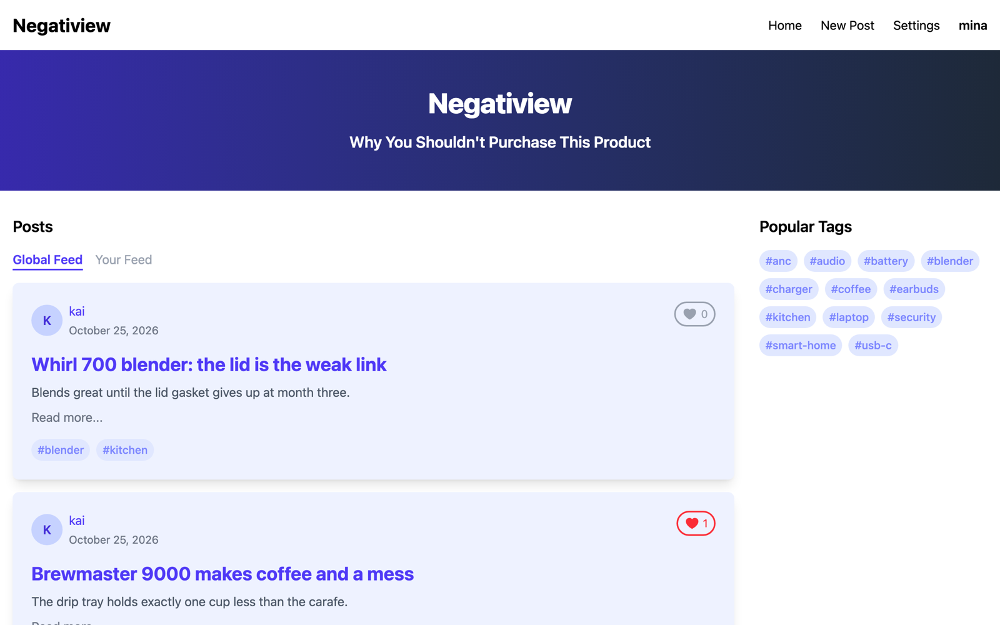
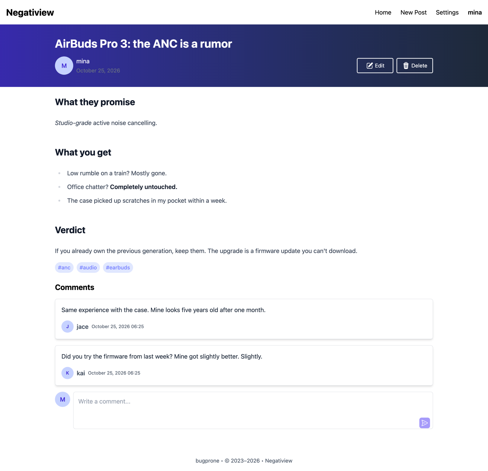
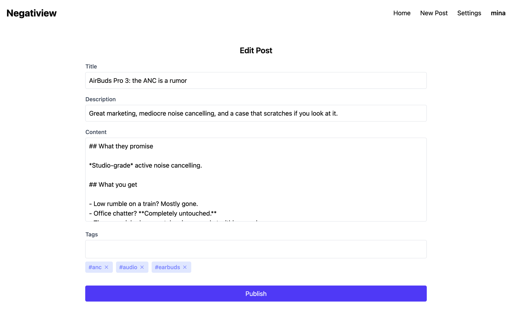
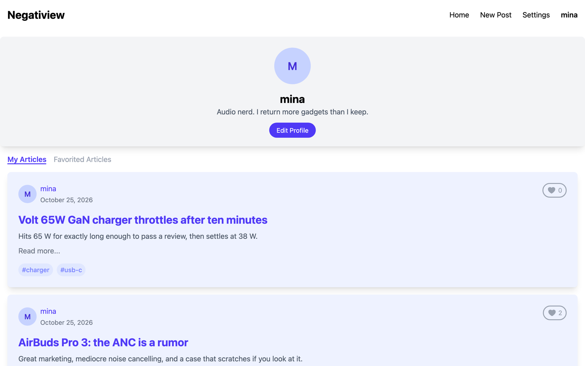
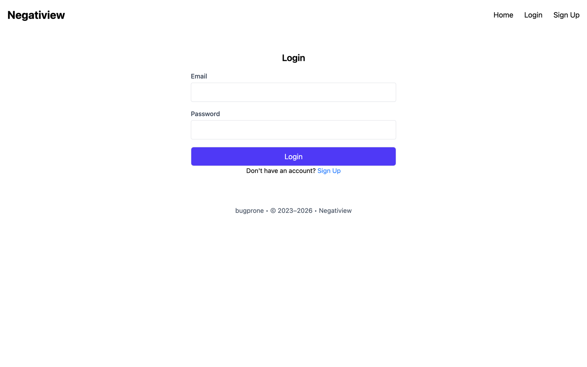
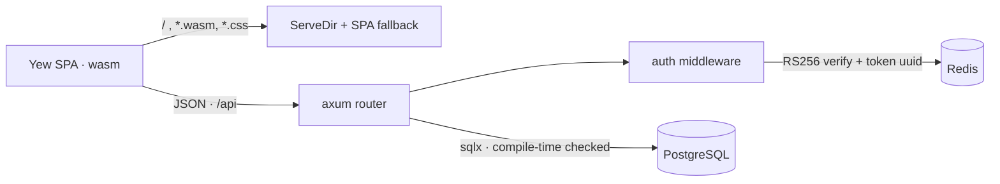

<h1 align="center">Negatiview</h1>

<p align="center"><em>Why you shouldn't purchase this product.</em></p>

<p align="center">
  <a href="https://github.com/bugprone/negatiview/actions/workflows/ci.yml"></a>
  
  
  
  <a href="LICENSE"></a>
</p>

A [RealWorld](https://github.com/gothinkster/realworld)-style publishing
platform for negative product reviews, written end to end in Rust. The server
is Axum + SQLx on PostgreSQL with Redis for token revocation. The client is Yew
compiled to WebAssembly and styled with Tailwind v4. One binary serves both.

<p align="center">
  
</p>

## Highlights

- **Every SQL statement is type-checked at compile time.** `sqlx::query!`
  validates each query against the real schema and the metadata is committed
  under `.sqlx/`, so a wrong column name is a build error and CI needs no
  database.
- **Stateless auth with real revocation.** RS256 JWTs carry a `token_uuid`;
  Redis maps that uuid to the token with the same TTL. Verification needs only
  the public key, revocation is a key delete.
- **Same-origin, single-binary deploy.** The Axum server mounts the Trunk
  bundle with `ServeDir`, falls back to `index.html` for client routes, and the
  client talks to `/api`. No CORS, no per-environment rebuild.
- **Rust on both sides of the wire.** Yew function components, `yew-router`,
  a context provider for the signed-in user, Markdown rendered in the browser
  with `pulldown-cmark` and styled by Tailwind Typography.
- **Current toolchain.** Rust 2024 edition, axum 0.8, sqlx 0.9, yew 0.23,
  Tailwind v4, clippy clean, CI on every push.

## Screenshots

| Post with rendered Markdown and comments | Editor |
|---|---|
|  |  |

| Profile | Login |
|---|---|
|  |  |

## Architecture



The full write-up, including the login sequence diagram, the entity
relationship diagram and the decision log, is in
[docs/ARCHITECTURE.md](docs/ARCHITECTURE.md).

## Features

- Email/password sign-up and login with RS256 JWTs. Short-lived access tokens
  and longer-lived refresh tokens are issued as HttpOnly cookies and also
  accepted as `Authorization: Bearer`.
- Posts written in Markdown, tagged, favorited, edited and deleted by their
  author.
- Comments, author profiles, follow/unfollow, and a personal feed built from
  the users you follow.
- Pagination, a popular-tags sidebar, and a global feed for anonymous visitors.

## Stack

| Layer | Crates |
|---|---|
| Server | `axum` 0.8, `tower-http`, `sqlx` 0.9 (PostgreSQL), `redis` 1.x, `jsonwebtoken` 11, `argon2`, `tokio` |
| Client | `yew` 0.23, `yew-router`, `yew-hooks`, `gloo-net`, `pulldown-cmark`, Tailwind CSS v4 |
| Tooling | Rust 2024 edition (MSRV 1.94), `trunk` (wasm bundler), `sqlx-cli` 0.9 (migrations, offline query cache), Docker Compose, GitHub Actions |

## API

All routes live under `/api`. Routes marked 🔒 need a valid access token.

| Method | Path | Description |
|---|---|---|
| GET | `/health` | Liveness check |
| POST | `/user/sign_up` | Create an account |
| POST | `/user/login` | Issue access + refresh tokens |
| GET / PUT | `/user` 🔒 | Current user, update profile or password |
| GET | `/profile/{display_name}` 🔒 | Public profile |
| POST / DELETE | `/profile/{display_name}/follow` 🔒 | Follow / unfollow |
| GET / POST | `/posts` 🔒 | List (filter by tag, author, favorited) / create |
| GET | `/posts/feed` 🔒 | Posts from followed users |
| GET / PUT / DELETE | `/posts/{id}` 🔒 | Read / edit / delete a post |
| POST / DELETE | `/posts/{id}/favorite` 🔒 | Favorite / unfavorite |
| GET / POST | `/posts/{id}/comments` 🔒 | List / add comments |
| DELETE | `/posts/{id}/comments/{comment_id}` 🔒 | Delete a comment |
| GET | `/tags` | Popular tags |

Request and response bodies are wrapped in `{"data": ...}`.

## Getting started

Prerequisites: Rust 1.94+, the `wasm32-unknown-unknown` target, `trunk`,
`sqlx-cli`, Node 20+ (for the Tailwind v4 CLI) and Docker.

```bash
rustup target add wasm32-unknown-unknown
cargo install trunk sqlx-cli
(cd client && npm install)   # Tailwind CLI, used by Trunk's pre-build hook
```

1. **Configure.** Copy `.env.example` to `.env` and generate two RSA key pairs,
   one for access tokens and one for refresh tokens. The server reads them
   base64-encoded:

   ```bash
   cp .env.example .env
   openssl genrsa -out access.pem 4096 && openssl rsa -in access.pem -pubout -out access.pub.pem
   base64 -i access.pem  | tr -d '\n'   # -> ACCESS_TOKEN_PRIVATE_KEY
   base64 -i access.pub.pem | tr -d '\n' # -> ACCESS_TOKEN_PUBLIC_KEY
   # repeat for REFRESH_TOKEN_*
   ```

2. **Start PostgreSQL and Redis**, then create the database and run migrations:

   ```bash
   make up
   sqlx database create
   sqlx migrate run
   ```

3. **Run** both halves with hot reload. `dev.sh` starts `trunk serve` on
   http://localhost:8080 and proxies `/api` to the Axum server on port 8081
   (needs `cargo install cargo-watch`). Trunk's pre-build hook runs
   `npm run css` to regenerate `tailwind.css` from `client/input.css`:

   ```bash
   ./dev.sh
   ```

4. **Seed some data** (optional). `scripts/seed.py` creates three reviewers,
   six reviews, comments, follows and favorites through the public API:

   ```bash
   python3 scripts/seed.py http://localhost:8081/api
   ```

### Production build

```bash
cd client && trunk build --release && cd ..
cargo run --release --bin server -- --port 8080 --static-dir ./dist
```

### Building without a database

SQLx checks every `query!` against a live database at compile time. The
checked query metadata is committed under `.sqlx/`, so a plain
`cargo build` works offline:

```bash
SQLX_OFFLINE=true cargo check --workspace
```

After changing a query, refresh the cache with a database running:

```bash
cargo sqlx prepare --workspace
```

## Project layout

```
client/              Yew application (pages, components, API services, types)
client/input.css     Tailwind v4 entry (plus v3-compat base styles); built by `npm run css`
client/package.json  Tailwind CLI only; Rust is built by trunk
server/
  src/handlers/      Axum handlers per resource (user, profile, post, comment, tag)
  src/middlewares/   auth.rs: JWT verification + Redis token lookup; token.rs: issue/verify
  src/models/        Row types mapped from query_as!
  src/routes.rs      Router, CORS, tracing, static-file fallback
migrations/          SQLx migrations
docs/                Architecture write-up and screenshots
scripts/seed.py      Demo data through the API
dev.sh               trunk serve + cargo watch
```

## Roadmap

- `/user/refresh` and `/user/logout` endpoints: the refresh token is issued
  but not yet consumed, and logout is client-side only.
- Map database constraint violations (self-follow, duplicate email) to 4xx.
- Integration tests against a throwaway PostgreSQL in CI.

## License

[MIT](LICENSE)
