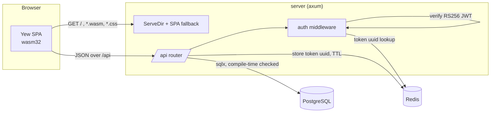
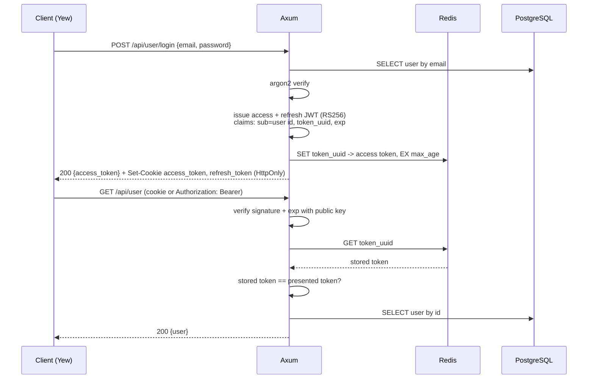
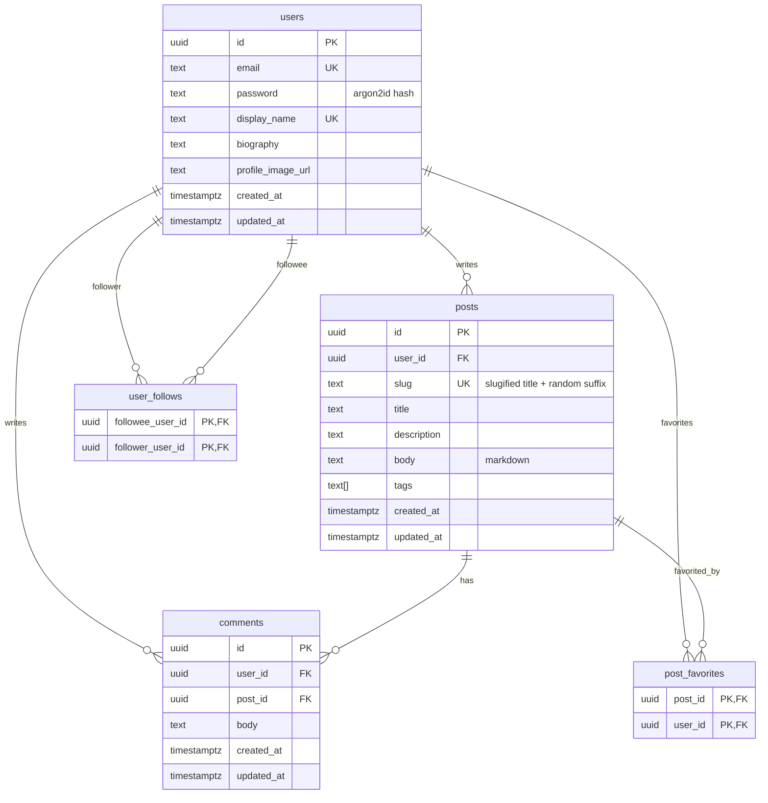

# Architecture

Negatiview is a two-crate Cargo workspace: an Axum API server and a Yew
single-page application compiled to WebAssembly. In production the server
serves the compiled client, so the whole deployment is one binary, one
PostgreSQL database and one Redis instance.

## Request lifecycle

1. `trunk` bundles the client into `dist/`. The server mounts that directory
   with `tower_http::services::ServeDir` and falls back to `index.html` for
   any unknown path, so client-side routes such as `/posts/<id>` deep-link
   correctly.
2. Everything under `/api` is a nested `axum::Router`. Handlers are plain
   `async fn`s that take extractors (`State`, `Path`, `Query`, `Json`) and
   return `(StatusCode, Json<Value>)`.
3. Routes that need a user run through the `auth` middleware
   (`server/src/middlewares/auth.rs`). It is applied per route with
   `route_layer(middleware::from_fn_with_state(..))`, so public endpoints such
   as `/api/tags` skip it entirely.
4. Database access goes through `sqlx::query!` / `query_as!`. Every SQL string
   is checked against the real schema at compile time, and the resulting
   metadata is committed under `.sqlx/` so the project builds without a
   database (`SQLX_OFFLINE=true`).

## Authentication

Passwords are hashed with Argon2id. Sessions are stateless JWTs signed with
RS256 so that a verifier never needs the signing key, plus a small amount of
server-side state in Redis so that a token can be revoked before it expires.

Design points:

- **Two transports.** The browser client relies on the `HttpOnly` cookie, API
  clients and tests use `Authorization: Bearer`. The middleware accepts either.
- **Revocation without sessions.** The JWT carries a `token_uuid`; Redis maps
  that uuid to the exact token with the same TTL as the JWT. Deleting the key
  invalidates the token immediately, and expired keys disappear on their own.
- **Keys from the environment.** The RSA key pairs are passed as base64 PEM in
  `ACCESS_TOKEN_*` / `REFRESH_TOKEN_*`, so nothing secret lives in the repo.
- **Anonymous access is explicit.** When no token is present the middleware
  still runs and inserts an `AuthUserClaims { user: None }` extension, so
  handlers can render a public post list and a personalised one from the same
  code path.

## Data model

Tags are a `TEXT[]` column rather than a join table: the tag list is a single
`SELECT DISTINCT ... FROM posts, unnest(tags)`, and filtering by tag is the
array containment operator `tags @> array[$1]`.
Favorite and follow counts are computed with correlated subqueries in the
post queries (`favorites_count`, `favorited`, `following_author`) so a post
list is one round trip.

## Client

The client is a conventional Yew application:

- `routes.rs` declares the `Routable` enum and the `Switch`.
- `pages/` are route components, `components/` are shared pieces (post
  preview, comment list, pagination, tag cloud).
- `services/` wrap the API per resource; `middlewares/request.rs` is the one
  place that knows about the base URL, JSON encoding and the bearer token
  (kept in `LocalStorage` and a `LazyLock<RwLock<_>>`). Requests go through
  `gloo-net`, a thin wrapper over the browser's `fetch`, so relative URLs
  work and no HTTP client is compiled into the wasm bundle.
- `middlewares/context.rs` exposes the signed-in user through a context
  provider; `use_user_context()` drives the header and the feed tabs.
- Effects that react to an async call are keyed on the call's
  `(data, error, loading)` state rather than on the hook handle. With yew
  0.23 the previous and current handle both observe the latest state, so an
  effect keyed on the handle itself never re-runs.
- Post bodies are Markdown rendered client-side with `pulldown-cmark` into a
  `prose` container (Tailwind Typography).
- `components/avatar.rs` falls back to the user's initial on a tinted disc
  when there is no profile picture.
- Styling is Tailwind v4. `client/input.css` imports Tailwind, points
  `@source` at the Rust files, and carries a small compatibility layer for v3
  defaults (border colour, placeholder colour, button cursor). Trunk runs the
  Tailwind CLI as a pre-build hook.

The API base URL is `/api`, same-origin. In development `trunk serve` proxies
it to the server; in production the server serves both, so there is no
CORS configuration to get wrong and no rebuild between environments.

## Decisions and trade-offs

| Decision | Why | Cost |
|---|---|---|
| Compile-time checked SQL (`sqlx::query!`) | Schema drift fails the build, not a request | Needs a database or the committed `.sqlx` cache to compile |
| RS256 instead of HS256 | Public key can be handed to other services; private key stays with the issuer | Key management is on the operator |
| Redis for token revocation | Immediate revocation while keeping JWT statelessness for verification | One more moving part |
| Single binary serves the SPA | Trivial deploy, no CORS | Server restarts to ship a client change |
| `TEXT[]` tags | Simple queries, no join table | No tag metadata, no rename without touching every post |
| Markdown rendered in the browser | Server stores plain text, zero server CPU on render | Sanitisation is the client's job |

## Known limitations

- The refresh token is issued but there is no `/refresh` or `/logout`
  endpoint yet; expiry is the only way out of a session.
- Database constraint violations (following yourself, duplicate email) surface
  as 500 rather than 4xx.
- There is no server-side test suite; CI compiles, lints and type-checks every
  query, and the API is exercised manually against a local stack.
